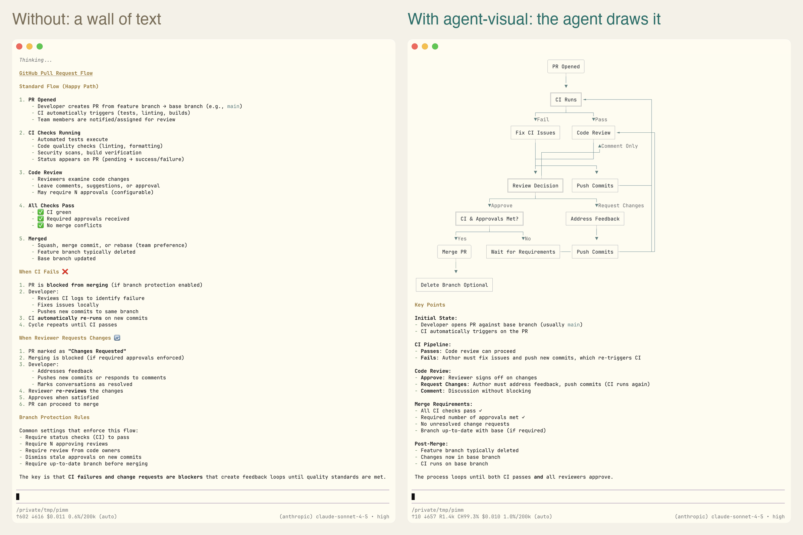
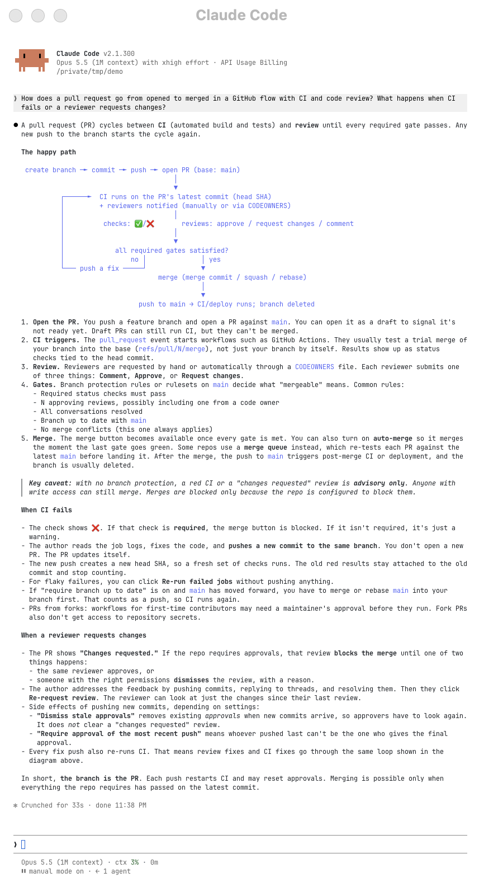
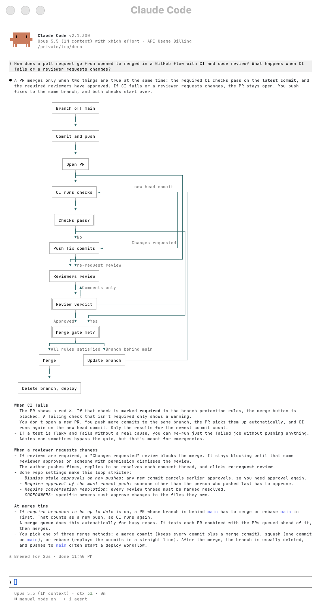
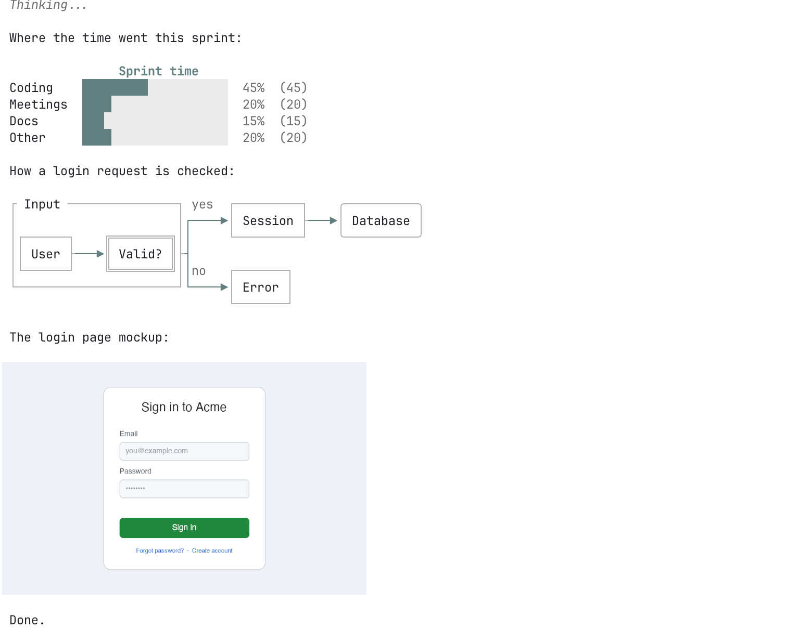
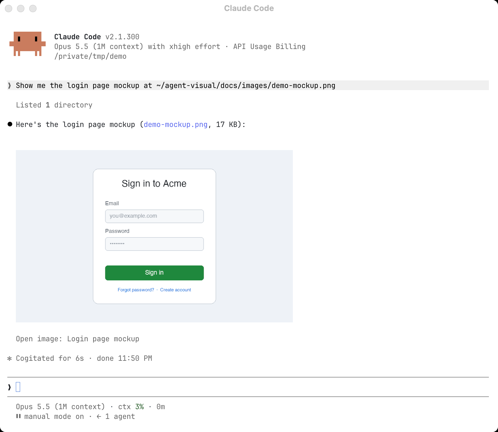
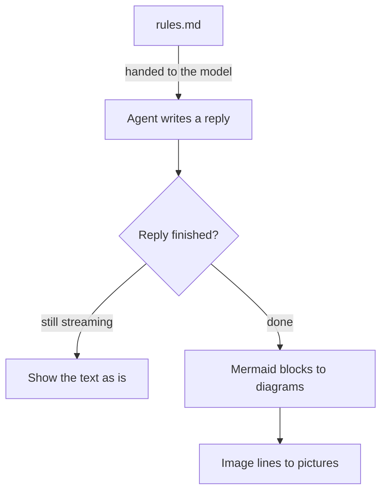

<div align="center">

# agent-visual

Your coding agent explains things with pictures, right in the terminal.

Mermaid diagrams drawn in place, local images shown inside the reply, and rules that make the agent reach for them on its own. For [Claude Code](https://docs.anthropic.com/en/docs/claude-code) and [pi](https://github.com/earendil-works/pi).

[](LICENSE)


[中文说明](README.zh-CN.md)



</div>

## Why

Ask a coding agent how a flow works and you get a wall of text, or a ```mermaid block you cannot see. You read it twice and still draw the boxes in your head.

agent-visual changes what the agent shows, not only how it is drawn:

- **It draws.** Every Mermaid block in a reply becomes a box-drawing diagram in place, in your theme's colors. The saved message does not change.
- **It shows images.** A line `` in a reply shows that local picture inside the reply. The plugin reads the file on your machine; the image never enters the model's context.
- **It reminds the agent.** A short set of rules ([rules.md](rules.md), about 850 tokens) is handed to the model now and then. It asks for a diagram wherever the answer has a shape (a flow, a state machine, a schema, a schedule), for words that carry what the diagram cannot (the reason, the numbers, the traps) instead of retelling it, and for a screenshot instead of a description.

Claude Code and pi share the same drawing code and the same rules, so a diagram looks the same in both. The same question in Claude Code:

| Without agent-visual | With agent-visual |
|---|---|
|  |  |

## Quick start

Nothing else to install: the code runs inside Claude Code or pi. Tested on macOS; on Linux everything but image conversion works (see [Limitations](#limitations)); Windows is untested.

### Claude Code

Claude Code 2.1.287 or newer (check with `claude --version`, upgrade with `claude update`).

```sh
claude plugin marketplace add suyuan2022/agent-visual
# plugin@marketplace: both are named agent-visual
claude plugin install agent-visual@agent-visual
```

Start a new session.

### pi

pi 1.4 or newer.

```sh
pi install git:github.com/suyuan2022/agent-visual
```

Turn off pi's built-in Mermaid renderer, so it does not draw the diagrams first in its own style. Merge this key into your existing `~/.pi/agent/settings.json`:

```json
{ "markdown": { "mermaid": "off" } }
```

Run `/reload` in pi, or start pi again.

### Check it works

In a new session, ask:

> How does an order move from placed to refunded? What states can it be in?

The reply should contain a drawn state diagram, not ```mermaid source.

If you still see source:

1. Check the plugin is on: `claude plugin list` shows `agent-visual@agent-visual` as enabled; in pi, `pi list` shows the package.
2. Test the drawing alone, without the model's choice in the way: ask the agent to repeat this block back verbatim.

   ````markdown
   ```mermaid
   flowchart LR
       A[Ask] --> B[Draw]
   ```
   ````

   A box-drawing diagram means drawing works and the model simply did not draw; source means the plugin is not running.
3. In pi, make sure `markdown.mermaid` is `off`, then `/reload`.

## What you get

### Diagrams, drawn where they are written

Ten common types are drawn: flowchart, sequenceDiagram, classDiagram, stateDiagram, erDiagram, pie, gantt, timeline, mindmap and gitGraph.



Nothing is lost when a diagram cannot be drawn:

- Too wide for the window: a left-to-right flowchart is redrawn top to bottom; if it still does not fit, the source is shown in a frame, with a one-line note above it ("Diagram can't be displayed at this width"); widen the window and it redraws.
- The plugin's own words (that line, legends) follow the reply: Chinese replies get Chinese, everything else English.
- A syntax error: the framed source and the error.
- An edge label with no room left: it is listed under the diagram instead of disappearing.
- While the reply is still streaming, the source shows; it becomes a diagram once the reply is done.

Other types (journey, quadrant, xychart, C4 and more) stay as framed source. In Claude Code, the `experimentalTypes` setting tries to draw them too.

### Images inside the reply

Put an image on a line of its own:

```markdown

```

- Shown at its own size, scaled down to fit the window.
- Set the width or center it with a title: ``, where `w` is a width in columns.
- The path must be absolute or start with `~/`. png, jpg, gif and webp work.
- In pi, click the picture to open it full size. In Claude Code, click its name under it.

The rules already teach the agent this line, so it uses it when it wants to show you a screenshot or a mockup.



## How it works



- **Claude Code**: a plugin that rewrites each reply on screen through the `ui.render` hook, and adds the rules with the `prompt.context` and `prompt.submit` hooks.
- **pi**: an extension with a Markdown transformer for the drawing, and a context hook that slips the rules in before each model call without saving them to the session.
- Both import `core/`, built on a patched copy of [lovely-mermaid](https://github.com/xl0/lovely-mermaid).

## Terminal support

Diagrams work in any terminal. Images need a terminal with an image protocol. Only Ghostty has been verified; the other rows follow each host's documented support:

| Terminal | Claude Code images | pi images | pi click to open |
|---|---|---|---|
| Ghostty | yes | yes | yes |
| kitty | yes (not tested) | yes (not tested) | yes (not tested) |
| Rex | a coarse preview in half blocks | yes | yes |
| iTerm2, WezTerm | a coarse preview in half blocks (not tested) | yes (not tested) | yes (not tested) |
| Others, or inside tmux | a coarse preview in half blocks (macOS only) | no: the name as a link | click the link |

Claude Code draws real pictures only in kitty and Ghostty. Everywhere else the plugin draws the picture with half-block characters, two pixels a cell: enough to see the layout, not to read small text. Click the name under it to open the file.

## Make it yours

The rules are the file [rules.md](rules.md) at the repo root; both hosts read the same file. Edit it to change how the agent draws.

- Claude Code: added at the start of a session and after a compaction or `/clear`, then again with every fifth message you type.
- pi: added next to your first message and every fifth one after it, only for the model; the session file does not keep it.
- pi also appends your own `~/.pi/agent/reminder.md` and the project's `.pi/reminder.md` if they exist, a good place for your personal reply style.

### Claude Code settings

Run `/plugin configure agent-visual@agent-visual` in Claude Code:

| Setting | Default | What it does |
|---|---|---|
| `edgeColor` | `teal` | Theme color for lines and arrows: teal, gray, blue or orange |
| `experimentalTypes` | off | Also try the less common diagram types |
| `cellSize` | `auto` | Pixels per character cell, which sets image size. `auto` is 14x28 on macOS; write a value such as `16x32` |

## Uninstall

```sh
claude plugin uninstall agent-visual@agent-visual
claude plugin marketplace remove agent-visual
pi remove git:github.com/suyuan2022/agent-visual
```

In pi, set `markdown.mermaid` back to its default by deleting the key.

## Limitations

- Only Mermaid blocks and image lines at the top level are handled; inside a list or a quote they stay as written.
- Nodes are drawn as rectangle, rounded or diamond; other `@{ shape }` values fall back to these. Labels are one line, and `<br>` becomes a space.
- Claude Code on Linux has no `sips`, so non-PNG images and PNGs over 2 MiB show as a link only.
- Tested on macOS only.

## Repository layout

- `core/`: the drawing code both hosts share, and `vendor/lovely-mermaid/`, a patched copy of the renderer (changes listed in `core/vendor/README.md`)
- `claude-code/`: the Claude Code plugin hooks
- `pi/`: the pi extension
- `rules.md`: the rules both hosts give the model
- `tests/`: fixtures, including 316 examples from the Mermaid docs

## Development

```sh
claude plugin validate .
claude plugin test .
bun test pi/
node tests/upstream.mjs
```

## Credits and license

- Diagrams are drawn by [lovely-mermaid](https://github.com/xl0/lovely-mermaid) (Apache-2.0). This repo carries a patched copy; every change and why is in `core/vendor/README.md`.
- agent-visual is released under the [MIT License](LICENSE).
