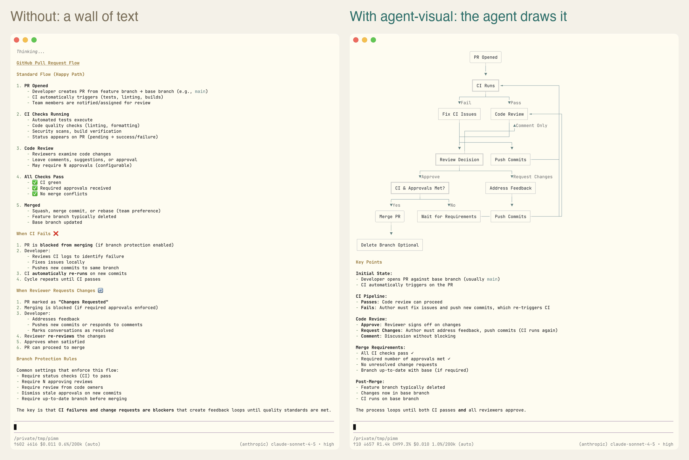
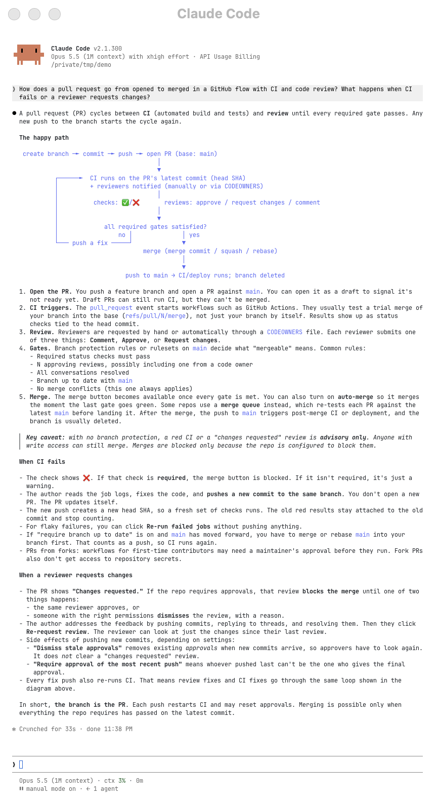
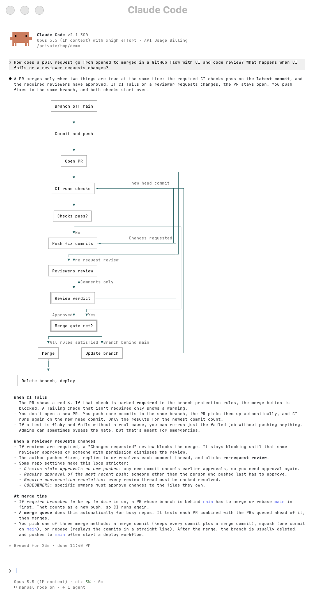
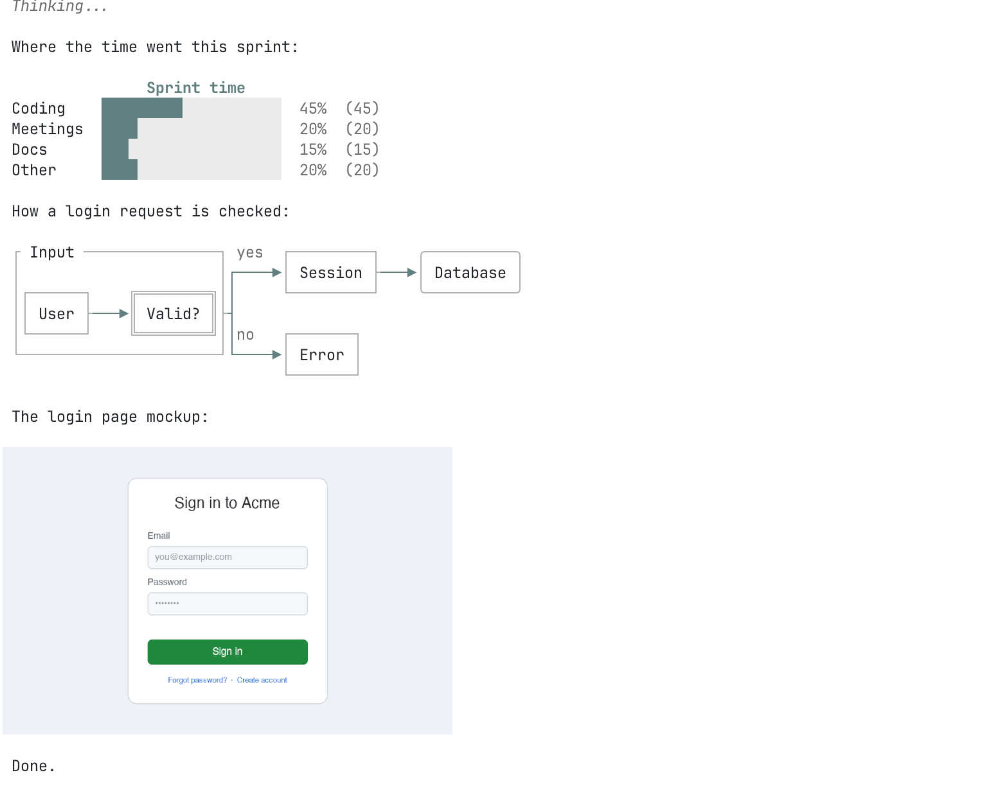
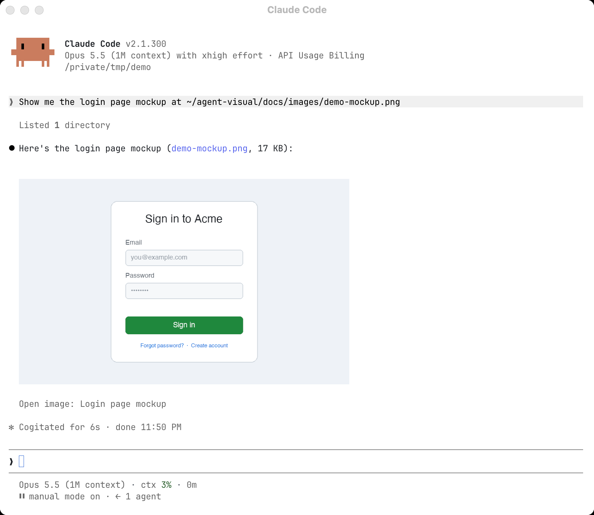
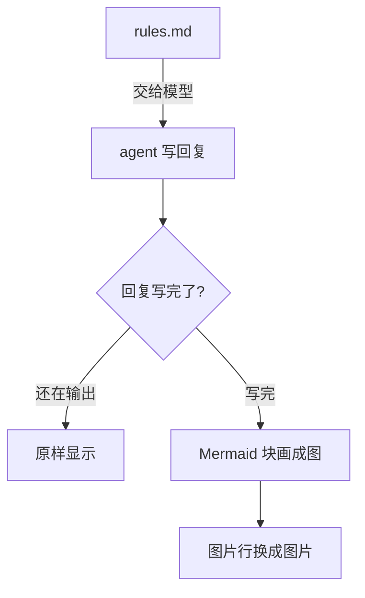

<div align="center">

# agent-visual

让 coding agent 在终端里用图把事讲清楚。

回复里的 Mermaid 原地画成图，本机图片直接显示在正文里，再提醒 agent 主动这么做。支持 [Claude Code](https://docs.anthropic.com/en/docs/claude-code) 和 [pi](https://github.com/earendil-works/pi)。

[](LICENSE)


[English](README.md)



</div>

## 为什么要它

问 coding agent 一个流程是怎么走的，得到的往往是一大段文字，或者一个你看不到效果的 ```mermaid 源码块。读两遍，脑子里还得自己把框画出来。

agent-visual 改变的是 agent 给你看什么，不只是怎么画：

- 画图：回复里的 Mermaid 块原地画成终端框线图，颜色跟着主题走。存下来的消息不变。
- 贴图：回复里单独一行 ``，这张本机图片就显示在正文里。图片由插件在本机读，不进模型上下文。
- 提醒：把一份简短的规矩（[rules.md](rules.md)，约 950 token）时不时交给模型。它要求讲原理、找原因、比方案、排计划的回复至少配一张合适的图，写文案、邮件、翻译这类成品文字时不配图；文字只写图表达不了的东西（原因、数字、坑），不把图再讲一遍；要给你看截图时直接贴图，而不是用文字描述。

Claude Code 和 pi 用同一套画图代码和同一份规矩，同一张图两边长得一样。在 Claude Code 里问同一个问题：

| 没装 agent-visual | 装了 agent-visual |
|---|---|
|  |  |

## 快速开始

不用另装任何东西，代码跑在 Claude Code 或 pi 里面。在 macOS 上测过；Linux 上除了图片格式转换都能用（见[已知限制](#已知限制)）；Windows 没测过。

### Claude Code

需要 Claude Code 2.1.287 或更新（`claude --version` 查版本，`claude update` 升级）。

```sh
claude plugin marketplace add suyuan2022/agent-visual
# 写法是 插件名@marketplace名，两个都叫 agent-visual
claude plugin install agent-visual@agent-visual
```

新开一个会话就生效。

### pi

需要 pi 1.4 或更新。

```sh
pi install git:github.com/suyuan2022/agent-visual
```

再关掉 pi 自带的 Mermaid 渲染，否则它会先用自己的样式把图画掉。把下面这个键合并进你现有的 `~/.pi/agent/settings.json`：

```json
{ "markdown": { "mermaid": "off" } }
```

然后在 pi 里执行 `/reload`，或者重开 pi。

### 装好了没有

新开一个会话，问一句：

> 订单从下单到退款有哪些状态，怎么流转？

回复里应该出现一张画好的状态图，而不是 ```mermaid 源码。

还是看到源码时：

1. 确认插件开着：`claude plugin list` 里 `agent-visual@agent-visual` 是 enabled；pi 里 `pi list` 能看到这个包。
2. 撇开模型、单测画图：让 agent 原样复述下面这段。

   ````markdown
   ```mermaid
   flowchart LR
       A[提问] --> B[画图]
   ```
   ````

   出现框线图，说明画图没问题，只是模型那次没画；还是源码，说明插件没在运行。
3. pi 里确认 `markdown.mermaid` 是 `off`，再执行 `/reload`。

## 能做什么

### 图就画在写它的地方

默认画常用的 10 种：flowchart、sequenceDiagram、classDiagram、stateDiagram、erDiagram、pie、gantt、timeline、mindmap、gitGraph。



画不出来时也不丢内容：

- 图比窗口宽：横向流程图先改成从上往下画，还放不下就显示带框源码，框上面一行写「当前宽度无法显示图表」；拉宽窗口就会重画。
- 插件自己显示的字（这行提示、图例）跟着回复的语言走：回复是中文就显示中文，其他都显示英文。
- 有语法错误：显示带框源码和错误。
- 连线上的文字实在放不下：列在图下面，不会悄悄消失。
- 回复还在输出时先显示源码，写完那一刻换成图。

其余图种（journey、quadrant、xychart、C4 等）显示成带框源码。Claude Code 里打开 `experimentalTypes` 设置可以试着画。

### 图片显示在正文里

单独一行写：

```markdown

```

- 按图片原始大小显示，大图缩到窗口放得下。
- 要指定宽度或居中，加 title：``，`w` 是列数。
- 路径必须是绝对路径或 `~/` 开头；支持 png、jpg、gif、webp。
- pi 里点图就能打开原图；Claude Code 里点图下面的图片名打开。

规矩里已经教了 agent 这种写法，它要给你看截图、原型图时会自己用。



## 原理



- Claude Code：插件用 `ui.render` hook 在屏幕上改写每条回复，用 `prompt.context` 和 `prompt.submit` hook 附上规矩。
- pi：扩展用 Markdown 转换器画图，用 context hook 在每次调用模型前临时插入规矩，不写进会话记录。
- 两边都调用 `core/`，底层是打过补丁的 [lovely-mermaid](https://github.com/xl0/lovely-mermaid)。

## 终端支持

画图在任何终端都能用。贴图要终端支持图片协议。只在 Ghostty 里实测过，其他行按各工具文档写明的支持情况填：

| 终端 | Claude Code 贴图 | pi 贴图 | pi 点图打开 |
|---|---|---|---|
| Ghostty | 能 | 能 | 能 |
| kitty | 能（未实测） | 能（未实测） | 能（未实测） |
| Rex | 能，要设 `CLAUDE_CODE_FORCE_TERMINAL_IMAGES=1`；不设时是半格方块画的粗略预览 | 能 | 能 |
| iTerm2、WezTerm | 用半格方块画的粗略预览（未实测） | 能（未实测） | 能（未实测） |
| 其他终端、tmux 里 | 用半格方块画的粗略预览（仅 macOS） | 不能：显示可点的图片名 | 点图片名打开 |

Claude Code 只在 kitty 和 Ghostty 里画真正的图片；Rex 里给它设上 `CLAUDE_CODE_FORCE_TERMINAL_IMAGES=1` 也能画（比如在 `~/.zshrc` 里写 `[[ "$TERM_PROGRAM" == rex ]] && export CLAUDE_CODE_FORCE_TERMINAL_IMAGES=1`）。Rex 按图片原像素一比一地画、不按格子缩放，所以插件在 Rex 里按它报给这个格子的格子像素，把每张图先缩成格子的精确尺寸。其他终端里，插件用半格方块字符画图，一格两个像素：能看出版面，看不清小字。点图下面的图片名就能打开原图。

## 按自己的习惯改

规矩就是仓库根目录的 [rules.md](rules.md)，两边读同一份。改它就能改 agent 画图的习惯。

- Claude Code：会话开始、上下文压缩或 `/clear` 之后附一次，之后每 5 条你亲手发的消息再附一次。
- pi：第 1 条和之后每 5 条你亲手发的消息旁边临时插一次，只给模型看，不写进会话文件。
- pi 还会在后面拼上你自己的 `~/.pi/agent/reminder.md` 和项目里的 `.pi/reminder.md`（都可选），适合放个人的回复习惯。

### Claude Code 设置

在 Claude Code 里执行 `/plugin configure agent-visual@agent-visual`：

| 设置 | 默认 | 作用 |
|---|---|---|
| `edgeColor` | `teal` | 连线和箭头用哪个主题色：teal、gray、blue、orange |
| `experimentalTypes` | 关 | 试画不常用的图种 |
| `cellSize` | `auto` | 一个字符格多少像素，决定图片显示多大；`auto` 在 macOS 上按 14x28，也可以写 `16x32` 这样的值 |

## 卸载

```sh
claude plugin uninstall agent-visual@agent-visual
claude plugin marketplace remove agent-visual
pi remove git:github.com/suyuan2022/agent-visual
```

pi 里把 `markdown.mermaid` 这个键删掉，就恢复默认。

## 已知限制

- 只处理顶格写的 Mermaid 块和图片行，放在列表或引用里的保持原样。
- 节点外形只画矩形、圆角、菱形，其他 `@{ shape }` 归到这三种；标签只有一行，`<br>` 变成空格。
- Claude Code 在 Linux 上没有 `sips`，非 PNG 和大于 2 MiB 的 PNG 只显示链接。
- 在 Claude 桌面 App 的 Code 标签里，Mermaid 块和本机图片由 App 自己显示，能否画 Mermaid 取决于 App 自己的功能开关。插件在那里只负责交规矩；它的画图和 `w=60 center` 这类 title 只在终端生效。
- 只在 macOS 上测过。

## 目录

- `core/`：两边共用的画图代码，以及 `vendor/lovely-mermaid/`（打过补丁的画图库副本，改动见 `core/vendor/README.md`）
- `claude-code/`：Claude Code 插件的 hook
- `pi/`：pi 扩展
- `rules.md`：两边交给模型的规矩
- `tests/`：测试用例，含 Mermaid 官方文档的 316 个示例，以及 `tests/rules/`：检查 `rules.md` 用的场景

## 开发

```sh
claude plugin validate .
claude plugin test .
bun test pi/
node tests/upstream.mjs
```

改了 `rules.md` 要复测时（会调用 Claude Opus，每个版本约 42 次回答，外加一次评审）：

```sh
node tests/rules.mjs gen new rules.md
git show HEAD:rules.md > tests/rules/out/old-rules.md
node tests/rules.mjs gen old tests/rules/out/old-rules.md
node tests/rules.mjs score old new
node tests/rules.mjs review old new
```

## 致谢和许可证

- 画图用 [lovely-mermaid](https://github.com/xl0/lovely-mermaid)（Apache-2.0）。本仓库带了一份打过补丁的副本，每处改动和原因见 `core/vendor/README.md`。
- agent-visual 以 [MIT 许可证](LICENSE) 发布。
